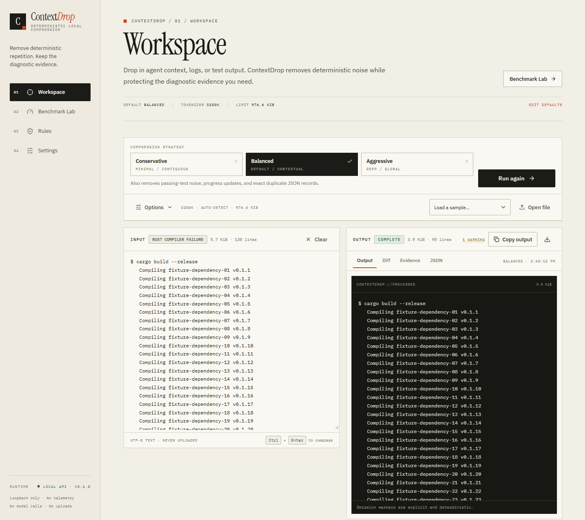
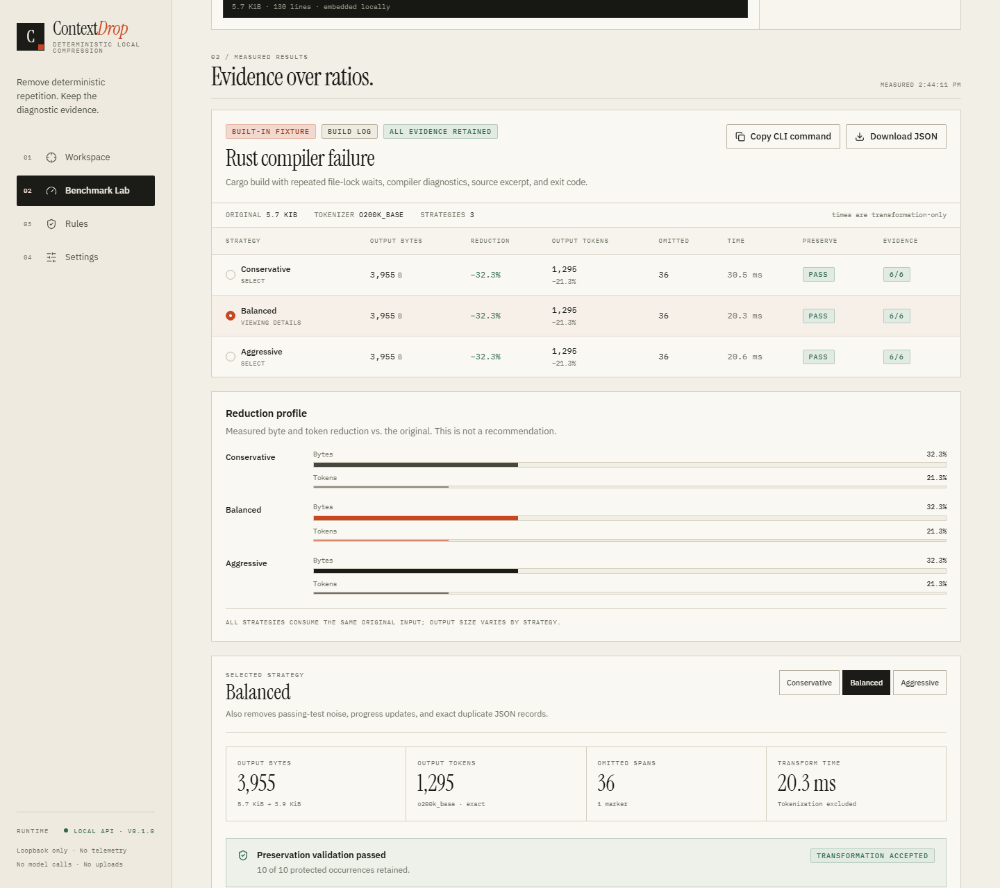

<p align="center">
  
</p>

<h1 align="center">ContextDrop</h1>

<p align="center"><strong>Deterministic context compression that keeps the diagnostic evidence.</strong></p>

<p align="center">
  Local-first Rust engine · CLI · stdio MCP · loopback API · React dashboard<br />
  No model calls · No telemetry · Apache-2.0 · v0.1.0 (pre-1.0)
</p>

ContextDrop removes repetitive build output, passing tests, progress bars, duplicate JSON records, and normalized log noise before context reaches an AI coding agent. Unlike model-based compressors, it uses a fixed rule set, protects diagnostic evidence, validates the result, and returns the original unchanged when a safe reduction is not possible.



## Why it exists

Agent context fills with repetition: hundreds of `Compiling …` lines before one type error, 143 passing tests before one failed assertion, identical health-check logs around a single 500. Sending all of it wastes tokens and attention. Filtering it with ad-hoc scripts often removes the line that explains the failure.

ContextDrop is built around three constraints:

1. **Repetition is removable; evidence is not.** Errors, failures, stack frames, paths with line numbers, exit codes, security findings, command context, and user-specified identifiers are protected.
2. **The result must be explainable.** Every run reports the strategy, classification, omissions, metrics, tokenizer, validation checks, and warnings.
3. **Safety beats savings.** If validation fails or the candidate is not smaller, ContextDrop returns the input unchanged. Savings are measured, never guaranteed.

## What it does

- **Three deterministic strategies** with increasing scope.
- **Evidence protection** for error/failure markers, security warnings, failed assertions, traces, panic/backtrace frames, paths and line numbers, exit codes, commands, and build/test summaries.
- **Adjacent-context retention** so an error keeps its caret, source excerpt, or surrounding explanation.
- **Literal user patterns** for project-specific evidence. Patterns are substrings, never regex or code.
- **Text and JSON processing**, including structural deduplication of large duplicate record arrays.
- **Exact local tokenization** with `tiktoken-rs` (`o200k_base` default, `cl100k_base` optional), or a clearly labelled heuristic estimate.
- **Byte, character, token, and omission metrics** with preservation checks and explicit fallback reasons.
- **CLI workflows** for files and stdin, text or JSON output, unified diffs, and benchmark evidence assertions.
- **Native stdio MCP** so agents can compress pasted text or read and compress an explicit log file without first loading the raw file.
- **A real local dashboard** with Workspace, Benchmark Lab, Rules, and Settings. It calls the same engine; it does not display fabricated data.
- **A loopback-only API** with strict Host/Origin checks and no request-content logging.

### Strategies

| Strategy | What it removes | Intended use |
| --- | --- | --- |
| **Conservative** | Only consecutive exact repeated lines; for JSON, lexical whitespace | Maximum evidence safety, first pass |
| **Balanced** | Conservative plus contiguous passing-test runs, progress updates, and duplicate records in qualifying JSON arrays | Default for build/test/log context |
| **Aggressive** | Balanced plus global exact duplicate lines and normalized structured-log grouping | Maximum reduction; review the diff |

Protection is independent of strategy. A protected line and its adjacent context are never eligible for omission. JSON structural deduplication inserts a `$contextdrop` marker and emits a schema-change warning; do not use it where exact JSON shape is required.

## Install

### One-line install (recommended)

Windows PowerShell:

```powershell
irm https://github.com/CyberBoyNitin/ContextDrop/releases/latest/download/install.ps1 | iex
```

macOS or Linux:

```bash
curl -fsSL https://github.com/CyberBoyNitin/ContextDrop/releases/latest/download/install.sh | bash
```

The installer downloads the release for your platform, verifies its SHA-256 checksum, installs the `contextdrop` CLI and `contextdrop-mcp` server into a user-local directory, and registers the MCP server with each supported client it detects:

- OpenCode
- Claude Code
- Claude Desktop
- Cursor

Restart the client, then ask it to compress a log. For example:

> Use contextdrop's `compress_context_file` tool on `C:\logs\build.log`, then explain the failure.

No Rust or Node installation is required. To skip client registration, pin a version, choose an install directory, or configure only one client, see [Install options](docs/INSTALL.md). Release assets and `.sha256` files are also on the [Releases](https://github.com/CyberBoyNitin/ContextDrop/releases) page.

The dashboard is not included in the release archives yet; build it from source with the steps below.

## Build from source

### Requirements

- Rust stable (workspace `rust-version = 1.85`; tested with 1.98)
- Node.js 20+ and npm for the optional dashboard (tested with Node 24)
- Windows, macOS, or Linux

### Build

From this repository checkout:

```bash
cargo build --release --workspace
```

On Unix, use `./target/release/contextdrop`; on Windows, use `target\release\contextdrop.exe`. The commands below use the Unix path.

### Connect an MCP agent

If you used the one-line installer above, the server is already registered and
you can skip this section. The steps here are for source builds and manual
setups.

The workspace builds `contextdrop-mcp`, a local stdio MCP server with no
network listener and no command-execution tool:

```bash
cargo build --release -p contextdrop-mcp
```

For OpenCode V2, add it under `mcp.servers` in `opencode.jsonc`:

```jsonc
{
  "$schema": "https://opencode.ai/config.json",
  "mcp": {
    "servers": {
      "contextdrop": {
        "type": "local",
        "command": [
          "C:/Users/you/Documents/ContextDrop/target/release/contextdrop-mcp.exe"
        ]
      }
    }
  }
}
```

Or register it from the command line:

```bash
opencode mcp add contextdrop --global -- /absolute/path/to/contextdrop-mcp
```

The server exposes `compress_context`, `compress_context_file`,
`inspect_protection`, and `list_protection_rules`. The file tool reads only the
explicit path it is given; it never writes. Claude Code, Claude Desktop, Cursor,
and generic stdio configurations are in [docs/MCP.md](docs/MCP.md).

Verified on October 24, 2026 with OpenCode 2.0.27: `opencode mcp list` reported
`contextdrop connected`, all four tools appeared in Code Mode, and a real
`compress_context_file` call reduced `fixtures/rust-build-failure.log` from
5,841 to 3,955 bytes, retained all 10 protected occurrences, and passed all
three preservation checks.

### Compress a file

```bash
./target/release/contextdrop compress fixtures/rust-build-failure.log --strategy balanced
```

Process stdin without executing it:

```bash
cat test-output.log | ./target/release/contextdrop compress --stdin --strategy conservative
```

Emit a machine-readable report:

```bash
./target/release/contextdrop compress build.log \
  --strategy aggressive \
  --format json > result.json
```

Write to a file safely:

```bash
./target/release/contextdrop compress build.log --output compressed.log
# Refuses to overwrite an existing file; add --force only when intentional.
```

Add project-specific evidence that must survive:

```bash
./target/release/contextdrop compress incident.log \
  --preserve "tenant_id=acme" \
  --preserve "deploy-target-7"
```

Compare original and output:

```bash
./target/release/contextdrop compare pytest-traceback.log
```

### Run the dashboard

Build the dashboard first, then start the loopback server from the repository root:

```bash
cd web
npm ci
npm run build
cd ..

cargo run -p contextdrop-server -- --bind 127.0.0.1:8787 --web-dir web/dist
```

Open <http://127.0.0.1:8787>. The server also exposes the local API at `/api/health`. It refuses non-loopback bind addresses.

### CLI exit codes

| Code | Meaning |
| ---: | --- |
| 0 | Success |
| 1 | Input, output, or configuration error |
| 2 | Command-line usage error |
| 3 | Benchmark evidence assertion failed |
| 4 | Input exceeded the configured size limit |
| 5 | Invalid structured input or engine error |

Use `contextdrop --help`, `contextdrop compress --help`, or `contextdrop benchmark --help` for all options.

## Dashboard

The dashboard has four functional surfaces:

- **Workspace** — load a fixture, local file, or pasted text; compress with any strategy; inspect Output, Diff, Evidence, and raw JSON; copy or download the result.
- **Benchmark Lab** — run all three strategies against the twelve fixtures or custom input; inspect per-strategy bytes, tokens, omissions, timing, preservation, and evidence checks.
- **Rules** — inspect the real protection map for a fixture, see why each line matched, and apply literal custom patterns.
- **Settings** — persist strategy, tokenizer, format, transform toggles, limits, custom patterns, and optional input-cost preferences locally.



All API calls stay on the loopback origin. The page does not load third-party scripts, fonts, or analytics, and the server sends a restrictive Content Security Policy. See [Privacy](docs/PRIVACY.md) for the complete data-flow description.

## Benchmark results

The repository includes twelve deterministic synthetic fixtures and 56 required-evidence assertions per strategy. On October 23, 2026, all **168/168** evidence checks passed across 36 real compression runs.

| Strategy | Output bytes | Byte reduction | Output tokens | Token reduction |
| --- | ---: | ---: | ---: | ---: |
| Original | 160,720 | — | 49,254 | — |
| Conservative | 130,003 | 19.11% | 40,232 | 18.32% |
| Balanced | 66,113 | 58.86% | 22,212 | 54.90% |
| Aggressive | 22,277 | 86.14% | 5,880 | 88.06% |

Exact token counts use `o200k_base`. These are results for this synthetic corpus only, not a promise for arbitrary logs. Aggressive was slightly larger than Balanced on the Jest and Pytest fixtures because normalized grouping added markers; the engine does not automatically pick the smallest strategy for you. The dense-source control produced no reduction under any strategy.

Reproduce the benchmark:

```bash
cargo run --release -p contextdrop-cli -- benchmark fixtures \
  --manifest fixtures/manifest.json \
  --tokenizer o200k_base \
  --format json > contextdrop-benchmark.json
```

Read [Benchmark methodology and results](docs/BENCHMARK_METHODOLOGY.md) for the full per-fixture table, measurement definitions, and interpretation limits.

## Security and privacy

- Compression core performs no filesystem, network, subprocess, or model I/O.
- The MCP server is local stdio only: it opens no sockets, executes nothing, writes no files, and reads only the explicit path passed to `compress_context_file`.
- The server binds only to loopback and rejects non-loopback bind addresses.
- API requests require a loopback `Host`; present `Origin` headers must be loopback.
- CORS is allowlisted, not `*`; POST bodies require JSON; responses are `no-store`.
- Limits: 1,000,000 input bytes by default, 4 MiB HTTP body, four concurrent API requests, 20-second processing timeout; MCP calls accept at most 4,000,000 input bytes.
- Input is never executed, and neither server logs nor persists request content.
- Dashboard input and results are not stored in browser storage; only preferences and custom patterns are.
- No telemetry, analytics, remote fonts, or remote tokenizer calls.
- The CLI refuses to overwrite an existing output file without `--force`.

Verified on October 24, 2026:

```text
cargo audit    0 vulnerabilities across 137 locked crate dependencies
npm audit      0 vulnerabilities in the dashboard npm tree (163 packages)
```

Details: [Threat model](docs/THREAT_MODEL.md) · [Privacy](docs/PRIVACY.md) · [Security policy](SECURITY.md).

## Testing

```bash
cargo fmt --all -- --check
cargo clippy --workspace --all-targets --all-features -- -D warnings
cargo test --workspace
cd web && npm ci && npm run build
```

Current verified result: **95 Rust tests pass** — 45 core unit tests, 3 property-based tests, 3 CLI unit tests, 10 CLI integration tests, 13 server tests, 17 MCP unit tests, and 4 spawned-process MCP stdio tests — plus the frontend type-check and production build. Clippy passes with warnings denied.

The test suite covers deterministic strategies, protected evidence, JSON validity, CRLF/trailing newline behavior, UTF-8 property tests, fallback behavior, file/stdin handling, overwrite protection, exit codes, API guards and limits, SPA routing, benchmark evidence failures, legacy and modern MCP handshakes, tool discovery, text/file compression, MCP size limits, and stdout purity.

## Repository structure

```text
crates/
  contextdrop-core/       Pure engine, tokenizer, preservation, benchmark runner
  contextdrop-cli/        clap CLI, safe file I/O, renderers, integration tests
  contextdrop-server/     Loopback Axum API, embedded fixtures, dashboard host
  contextdrop-mcp/        Local stdio MCP server, protocol and tool tests
web/
  src/                    React + TypeScript + Vite + Tailwind dashboard
  public/                 Static assets
fixtures/                 Twelve deterministic fixtures and manifest
scripts/                  Fixture generator and one-line installers
docs/                     Architecture, install, threat model, privacy, methodology, MCP, comparison
```

Architecture and data flow: [docs/ARCHITECTURE.md](docs/ARCHITECTURE.md). MCP client setup:
[docs/MCP.md](docs/MCP.md).

## How ContextDrop compares

ContextDrop is deliberately narrower than a compression proxy or an ML prompt compressor. It is for auditable, repeatable reduction of diagnostic context. It does not replace agent memory, prompt-cache management, or model-based prose compression.

- **Headroom** is broader: local proxy, SDKs, MCP, agent wrapping, reversible compression, cross-agent memory, and ML/AST compressors. ContextDrop now ships a local stdio MCP server, but it has no transparent proxy, reversibility store, or agent wrapper. Headroom's telemetry beacon is on by default (opt-out). It is generally the better fit for live agent traffic that needs reversibility and breadth.
- **LLMLingua** performs model-based prompt compression. It can reduce more prose, but its output is not a fixed evidence-preserving rule transformation.
- **Provider-native compaction** is convenient but opaque and not locally reproducible.
- **Manual filtering** is deterministic but has no standard evidence protection, validation, or fallback.

The full capability comparison, sourced claims, and “when to choose what” guidance are in [docs/COMPETITIVE_ANALYSIS.md](docs/COMPETITIVE_ANALYSIS.md).

## Limitations

- Protection is heuristic. It can over-protect repetition and can miss important lines in unusual formats or languages. Review the diff and add literal patterns.
- No semantic equivalence, answer-quality, or provider-billing guarantee. Presence checks only prove that selected strings survived.
- The benchmark corpus is synthetic and small; its percentages are not universal.
- JSON structural deduplication changes document shape by adding `$contextdrop`. Avoid it for strict schemas.
- Exact token counts are encoding-level counts that exclude chat framing, tool schemas, and provider overhead. MCP results also include a structured report, so reported savings are not total agent-context savings.
- The local HTTP API has no authentication. Other local processes may reach it; do not bind it beyond loopback.
- The MCP server is not a proxy or interceptor. The agent must call it explicitly. Its file tool has no sandbox or path allowlist and runs with the user's filesystem permissions. MCP clients may retain tool results under their own policies.
- The project is pre-1.0. APIs and output schemas may change before 1.0.

## Roadmap priorities

1. **Agent capture beyond explicit tool calls** — optional proxy or hook workflows and per-project preservation profiles; the local stdio MCP server is shipped.
2. **Broader evidence coverage and evaluation** — more real-world format fixtures, multilingual rules, and differential tests that measure whether important diagnostics survive.
3. **Distribution and release confidence** — reproducible signed builds, package-manager distribution, and performance measurements in release mode.

## Contributing

Issues and pull requests are welcome. Read [CONTRIBUTING.md](CONTRIBUTING.md) and [CODE_OF_CONDUCT.md](CODE_OF_CONDUCT.md) before contributing. Report security issues privately per [SECURITY.md](SECURITY.md), not in a public issue.

## License

Apache License 2.0. See [LICENSE](LICENSE).
