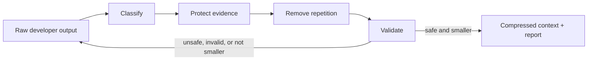
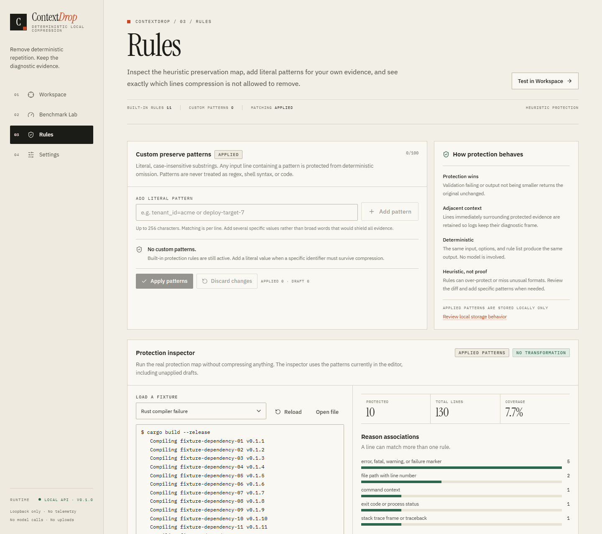

<p align="center">
  
</p>

<h1 align="center">ContextDrop</h1>

<p align="center">
  <strong>Deterministic context compression for AI coding agents.</strong><br />
  Drop the noise. Keep the evidence.
</p>

<p align="center">
  <sub>Local-first Rust engine · CLI · stdio MCP · loopback API · React dashboard</sub>
</p>

<p align="center">
  <a href="https://github.com/CyberBoyNitin/ContextDrop/actions/workflows/ci.yml"></a>
  <a href="https://github.com/CyberBoyNitin/ContextDrop/releases"></a>
  <a href="LICENSE"></a>
  <a href="https://www.rust-lang.org"></a>
  <a href="https://modelcontextprotocol.io"></a>
  
</p>

<p align="center">
  <a href="#install"><strong>Install</strong></a> ·
  <a href="#quick-start">Quick start</a> ·
  <a href="#how-it-works">How it works</a> ·
  <a href="#benchmarks">Benchmarks</a> ·
  <a href="#documentation">Documentation</a>
</p>

---

ContextDrop compresses build logs, test output, structured logs, and JSON before they reach an AI coding agent. It removes repetition and noise while protecting the errors, stack traces, and assertions needed to debug — locally, deterministically, and without a model call.

Use it as a CLI, a stdio MCP server, a loopback API, or a local dashboard. Every run produces a report covering what was removed, why, and what survived.

<p align="center">
  
  <br />
  <sub>Workspace: a 5.7 KiB Rust compiler log compressed to 3.9 KiB, with all 10 protected occurrences retained.</sub>
</p>

| Principle | What it means |
| --- | --- |
| **Deterministic** | A fixed rule set, not a model. The same input and options produce the same compressed text and decisions. |
| **Evidence-preserving** | Errors, failures, stack frames, and assertions are protected by default. Omissions are counted and reported. |
| **Local-first** | CLI, stdio MCP, and loopback dashboard. No telemetry or analytics. |
| **Auditable** | Byte and token metrics, diffs, preservation checks, and machine-readable reports. |

<details>
<summary><strong>Contents</strong></summary>

- [Why ContextDrop](#why-contextdrop)
- [Install](#install)
- [Quick start](#quick-start)
- [How it works](#how-it-works)
- [Strategies](#strategies)
- [Evidence protection](#evidence-protection)
- [Dashboard](#dashboard)
- [Benchmarks](#benchmarks)
- [Security and privacy](#security-and-privacy)
- [Build from source](#build-from-source)
- [Documentation](#documentation)
- [How ContextDrop compares](#how-contextdrop-compares)
- [Limitations](#limitations)
- [Roadmap](#roadmap)
- [Contributing](#contributing)
- [License](#license)

</details>

## Why ContextDrop

Agent context fills with repetition: hundreds of `Compiling …` lines before one type error, 143 passing tests before one failed assertion, identical health-check logs around a single 500. Sending all of it wastes tokens and attention. Filtering it with an ad-hoc script often removes the line that explains the failure.

ContextDrop is built around three constraints:

1. **Repetition is removable; evidence is not.** Errors, failures, stack frames, paths with line numbers, exit codes, security findings, command context, and user-specified identifiers are protected.
2. **The result must be explainable.** Every run reports the strategy, classification, omissions, metrics, tokenizer, validation checks, and warnings.
3. **Safety beats savings.** If validation fails or the candidate is not smaller, ContextDrop returns the input unchanged. Savings are measured, never guaranteed.

## Install

**Windows (PowerShell)**

```powershell
irm https://github.com/CyberBoyNitin/ContextDrop/releases/latest/download/install.ps1 | iex
```

**macOS / Linux**

```bash
curl -fsSL https://github.com/CyberBoyNitin/ContextDrop/releases/latest/download/install.sh | bash
```

The installer downloads the release for your platform, verifies its published SHA-256 checksum, installs the `contextdrop` CLI and `contextdrop-mcp` server into a user-local directory, and registers the MCP server with each supported client it detects:

- OpenCode
- Claude Code
- Claude Desktop
- Cursor

Windows installs to `%LOCALAPPDATA%\ContextDrop\bin`; macOS and Linux install to `~/.local/bin` and print the PATH line if needed. No Rust or Node installation is required.

Restart the client, then ask it to compress a log:

> Use ContextDrop's `compress_context_file` tool on `./logs/build.log`, then explain the failure.

| Platform | Architectures |
| --- | --- |
| Windows | x64 |
| Linux | x64, arm64 |
| macOS | Apple Silicon, Intel |

Prebuilt binaries cover the platforms above; other targets can build from source. To pin a version, choose an install directory, skip client registration, or configure a mirror, see [Install options](docs/INSTALL.md).

Release installs were verified on Windows 11 and Linux (WSL), including checksum verification and registration with OpenCode, Claude Code, Claude Desktop, and Cursor. Deliberately corrupted archives are rejected.

> [!NOTE]
> Release archives currently ship the CLI and MCP server. The dashboard is source-built — see [Build from source](#build-from-source).

## Quick start

### Use with an AI agent (MCP)

1. Run the installer.
2. Restart your AI client.
3. Ask it to compress a file or pasted text. The server exposes four tools:

| Tool | Purpose |
| --- | --- |
| `compress_context` | Compress text already in the conversation. |
| `compress_context_file` | Read and compress an explicit local file. |
| `inspect_protection` | Show which lines would be protected and why. |
| `list_protection_rules` | List the built-in evidence rules. |

The MCP server is local stdio only: it opens no sockets, executes nothing, and reads only the path passed to `compress_context_file`. Client-specific setup is in [MCP setup](docs/MCP.md).

Verified with OpenCode 2.0.27: all four tools appeared in Code Mode, and a real `compress_context_file` call reduced the Rust fixture from 5,841 to 3,955 bytes while retaining all 10 protected occurrences.

### Use from the CLI

```bash
# Balanced is the default
contextdrop compress build.log

# Read from stdin
cat test-output.log | contextdrop compress --stdin --strategy conservative

# Machine-readable metrics and report
contextdrop compress build.log --strategy aggressive --format json > result.json

# Write to a new file safely (existing files require --force)
contextdrop compress build.log --output compressed.log

# Keep project-specific evidence that must survive
contextdrop compress incident.log --preserve "tenant_id=acme" --preserve "deploy-target-7"

# Review a real unified diff
contextdrop compare pytest-traceback.log
```

On Windows PowerShell, replace `cat` with `Get-Content`. The CLI writes processed text to stdout and diagnostics to stderr, so it composes safely in scripts. It refuses to overwrite an existing output file unless `--force` is passed. From a source build, use `./target/release/contextdrop` (`target\release\contextdrop.exe` on Windows); run `contextdrop --help` for the full reference.

<details>
<summary><strong>CLI exit codes</strong></summary>

| Code | Meaning |
| ---: | --- |
| 0 | Success |
| 1 | Input, output, or configuration error |
| 2 | Command-line usage error |
| 3 | Benchmark evidence assertion failed |
| 4 | Input exceeded the configured size limit |
| 5 | Invalid structured input or engine error |

</details>

## How it works



| Stage | What happens |
| --- | --- |
| **Classify** | Detects build logs, test output, terminal/progress output, structured logs, JSON, or plain text. |
| **Protect** | Marks errors, failures, stack frames, paths with line numbers, exit codes, security findings, commands, summaries, and custom literals. Adjacent context is protected too. |
| **Reduce** | Removes exact repetition, passing-test runs, progress updates, duplicate log records, and normalized noise according to the selected strategy. |
| **Validate** | Confirms protected occurrences survived, structured output is valid, and the candidate is smaller. |
| **Fallback** | Returns the original input unchanged when a safe reduction is not possible. |

Every run produces a report with the strategy, classification, omission spans, byte and token metrics, tokenizer, preservation checks, and warnings. Tokenization is local and explicit: `o200k_base` by default, `cl100k_base` optional, or a clearly labelled heuristic estimate.

| Surface | Use it for | Entry point |
| --- | --- | --- |
| **CLI** | One-off compression, scripts, CI | `contextdrop compress` |
| **MCP** | Let an agent compress explicitly | Installer + restart your client |
| **API** | Local integrations and the dashboard | `contextdrop-server` on loopback |
| **Dashboard** | Inspect diffs, evidence, and benchmarks | Source build for now |

Workspace layout: `contextdrop-core` is the engine; `contextdrop-cli`, `contextdrop-server`, and `contextdrop-mcp` are adapters over the same engine; `web/` is the React dashboard.

## Strategies

All strategies share the same protection layer. They differ only in how much repetition they remove.

| Strategy | What it removes | Intended use |
| --- | --- | --- |
| **Conservative** | Consecutive exact repeated lines; lexical whitespace in JSON | Maximum evidence safety, first pass |
| **Balanced** (default) | Conservative plus contiguous passing-test runs, progress updates, and duplicate records in qualifying JSON arrays | Default for build, test, and log context |
| **Aggressive** | Balanced plus global exact duplicate lines and normalized structured-log grouping | Maximum reduction; review the diff |

Protection is independent of strategy: a protected line and its adjacent context are never eligible for omission. JSON structural deduplication inserts a `$contextdrop` marker and emits a schema-change warning; do not use it where the exact JSON shape is required.

## Evidence protection

ContextDrop's first job is not compression; it is making compression safe to inspect.

**Protected by default**

- Compiler errors and warnings, including carets and source excerpts
- Test failures, failed assertions, and build/test summaries
- Panic messages, stack traces, and backtrace frames
- Paths with line and column numbers, exit codes, and commands
- Security scan findings and HTTP errors
- User-specified literal patterns

**Validated on every run**

- Protected occurrences are counted in the input and output.
- Preservation checks fail closed.
- The result must be smaller; otherwise the original is returned.
- JSON output must remain parseable.
- Omission spans and counts are reported.

<p align="center">
  
  <br />
  <sub>Rules: the real protection map for the Rust compiler fixture — 10 protected occurrences across 130 lines, with the rule behind each match.</sub>
</p>

Literal patterns are case-insensitive substrings, never regex or executable code. Adjacent context is retained so an error keeps its caret, source excerpt, or surrounding explanation.

## Dashboard

The dashboard is a local React interface over the same engine. It has four surfaces:

- **Workspace** — load a fixture, local file, or pasted text; compress with any strategy; inspect Output, Diff, Evidence, and raw JSON; copy or download the result.
- **Benchmark Lab** — run all three strategies against the twelve fixtures or custom input; inspect bytes, tokens, omissions, timing, preservation, and evidence checks.
- **Rules** — inspect the protection map for a fixture, see why each line matched, and apply literal custom patterns.
- **Settings** — persist strategy, tokenizer, format, transform toggles, limits, custom patterns, and optional input-cost preferences locally.

<p align="center">
  
  <br />
  <sub>Benchmark Lab: the Rust compiler fixture at 32.3% byte reduction, with evidence and preservation checks passing.</sub>
</p>

All API calls stay on the loopback origin. The page loads no third-party scripts, fonts, or analytics, and the server sends a restrictive Content Security Policy. See [Privacy](docs/PRIVACY.md) for the complete data flow. Start it with the [source-build steps](#build-from-source).

## Benchmarks

The repository includes twelve deterministic synthetic fixtures and 56 required-evidence assertions per strategy. On October 23, 2026, all **168/168** evidence checks passed across 36 compression runs.

| Strategy | Output bytes | Byte reduction | Output tokens | Token reduction |
| --- | ---: | ---: | ---: | ---: |
| Original | 160,720 | — | 49,254 | — |
| Conservative | 130,003 | 19.11% | 40,232 | 18.32% |
| **Balanced** (default) | 66,113 | 58.86% | 22,212 | 54.90% |
| Aggressive | 22,277 | 86.14% | 5,880 | 88.06% |

Exact token counts use `o200k_base`. These results describe this synthetic corpus, not arbitrary logs. Aggressive was slightly larger than Balanced on the Jest and Pytest fixtures because normalized grouping added markers; ContextDrop does not automatically choose the smallest strategy. The dense-source control produced no reduction under any strategy.

From a repository checkout, reproduce the benchmark with:

```bash
cargo run --release -p contextdrop-cli -- benchmark fixtures \
  --manifest fixtures/manifest.json \
  --tokenizer o200k_base \
  --format json > contextdrop-benchmark.json
```

Read [Benchmark methodology and results](docs/BENCHMARK_METHODOLOGY.md) for the per-fixture table, measurement definitions, and interpretation limits.

## Security and privacy

ContextDrop is designed to be inspectable and boring: local processes, explicit inputs, no hidden network calls.

**Data handling**

- The compression core performs no filesystem, network, subprocess, or model I/O.
- The MCP server is local stdio only: it opens no sockets, executes nothing, writes no files, and reads only the explicit path passed to `compress_context_file`.
- Input is never executed. Neither server logs nor persists request content.
- Dashboard input and results are not stored in browser storage; only preferences and custom patterns are.
- No telemetry, analytics, remote fonts, or remote tokenizer calls.

**Network and API**

- The HTTP server binds only to loopback and rejects non-loopback bind addresses.
- API requests require a loopback `Host`; present `Origin` headers must be loopback.
- CORS is allowlisted, not `*`; POST bodies require JSON; responses are `no-store`.
- Limits: 1,000,000 input bytes by default, 4 MiB HTTP body, four concurrent API requests, a 20-second processing timeout, and a 4,000,000-byte MCP input limit.

**Files**

- The CLI refuses to overwrite an existing output file without `--force`.
- The MCP file tool has no path sandbox and runs with the user's filesystem permissions — only point it at files you intend to share with the agent.

Verified on October 24, 2026:

```text
cargo audit    0 vulnerabilities across 137 locked crate dependencies
npm audit      0 vulnerabilities in the dashboard npm tree (163 packages)
```

Release archives are built by GitHub Actions and verified by the installer's SHA-256 check. Binaries are not yet code-signed.

Details: [Threat model](docs/THREAT_MODEL.md) · [Privacy](docs/PRIVACY.md) · [Security policy](SECURITY.md).

## Build from source

### Requirements

- Rust 1.85+ (tested with 1.98)
- Node.js 20+ for the optional dashboard (tested with 24)
- Windows, macOS, or Linux

```bash
git clone https://github.com/CyberBoyNitin/ContextDrop.git
cd ContextDrop
cargo build --release --workspace
```

The build produces:

- `target/release/contextdrop` — CLI
- `target/release/contextdrop-mcp` — stdio MCP server

On Windows, the same files end in `.exe`.

### Run the dashboard

```bash
cd web
npm ci
npm run build
cd ..
cargo run -p contextdrop-server -- --bind 127.0.0.1:8787 --web-dir web/dist
```

Open <http://127.0.0.1:8787>. The server refuses non-loopback bind addresses.

### Register the MCP server manually

```bash
opencode mcp add contextdrop --global -- /absolute/path/to/contextdrop-mcp
```

For OpenCode JSON, Claude Code, Claude Desktop, Cursor, and generic stdio clients, see [MCP setup](docs/MCP.md).

### Tests

```bash
cargo fmt --all -- --check
cargo clippy --workspace --all-targets --all-features -- -D warnings
cargo test --workspace
cd web && npm ci && npm run build
```

The current suite has **95 Rust tests** — 45 core unit tests, 3 property-based tests, 3 CLI unit tests, 10 CLI integration tests, 13 server tests, 17 MCP unit tests, and 4 spawned-process MCP stdio tests — plus the frontend type-check and production build. CI runs the same checks.

## Documentation

| Document | What is inside |
| --- | --- |
| [Install options](docs/INSTALL.md) | One-line installers, flags, version pinning, updates, uninstall, troubleshooting |
| [MCP setup](docs/MCP.md) | OpenCode, Claude Code, Claude Desktop, Cursor, and generic stdio configuration |
| [Architecture](docs/ARCHITECTURE.md) | Crate boundaries, compression pipeline, data flow, invariants |
| [Benchmark methodology](docs/BENCHMARK_METHODOLOGY.md) | Corpus, metrics, per-fixture results, interpretation limits |
| [Threat model](docs/THREAT_MODEL.md) | Assets, trust boundaries, attack surface, mitigations |
| [Privacy](docs/PRIVACY.md) | Data flows, storage, and network behavior |
| [Competitive analysis](docs/COMPETITIVE_ANALYSIS.md) | Headroom, LLMLingua, provider compaction, and manual filtering |
| [Contributing](CONTRIBUTING.md) | Development setup, tests, and pull-request expectations |
| [Security policy](SECURITY.md) | Private vulnerability reporting |
| [Changelog](CHANGELOG.md) | Release history |

## How ContextDrop compares

ContextDrop is deliberately narrower than a compression proxy or an ML prompt compressor. It is for auditable, repeatable reduction of diagnostic context, not agent memory, prompt-cache management, or prose compression.

- **Headroom** — broader local proxy, SDK, MCP, agent-memory, and reversible-compression platform. A better fit when you need transparent live traffic and reversibility.
- **LLMLingua** — model-based prompt compression. It can reduce more prose, but its output is not a fixed, evidence-preserving rule transformation.
- **Provider-native compaction** — convenient, but opaque and not locally reproducible.
- **Manual filtering** — deterministic, but without standard evidence protection, validation, or fallback.

See the [full capability comparison](docs/COMPETITIVE_ANALYSIS.md) for sourced claims and "when to choose what" guidance.

## Limitations

- **Protection is heuristic.** It can over-protect repetition and miss important lines in unusual formats or languages. Review the diff and add literal patterns.
- **No semantic guarantee.** Preservation checks prove that selected strings survived, not that the answer will be correct or the bill lower.
- **The benchmark is synthetic.** The percentages are not universal.
- **JSON structural deduplication changes document shape.** It adds a `$contextdrop` marker; avoid it for strict schemas.
- **Token counts are encoding-level.** They exclude chat framing, tool schemas, and provider overhead. MCP results also include a structured report, so reported savings are not total agent-context savings.
- **Local surfaces are not sandboxed.** The HTTP API has no authentication; the MCP file tool runs with the user's filesystem permissions. Do not expose the API beyond loopback.
- **Pre-1.0.** APIs and output schemas may change before 1.0.

## Roadmap

1. **Agent capture beyond explicit tool calls** — optional proxy or hook workflows and per-project preservation profiles; the local stdio MCP server is shipped.
2. **Broader evidence coverage and evaluation** — more real-world format fixtures, multilingual rules, and differential tests that measure whether important diagnostics survive.
3. **Distribution and release confidence** — signed builds, package-manager distribution, and release-mode performance measurements.

## Contributing

Issues and pull requests are welcome. Read [CONTRIBUTING.md](CONTRIBUTING.md) and [CODE_OF_CONDUCT.md](CODE_OF_CONDUCT.md) first. Report security issues privately per [SECURITY.md](SECURITY.md), not in a public issue.

## License

Apache License 2.0. See [LICENSE](LICENSE).

---

<p align="center">
  <sub>Built in Rust. Runs locally. Calls no models. Apache-2.0.</sub>
</p>
